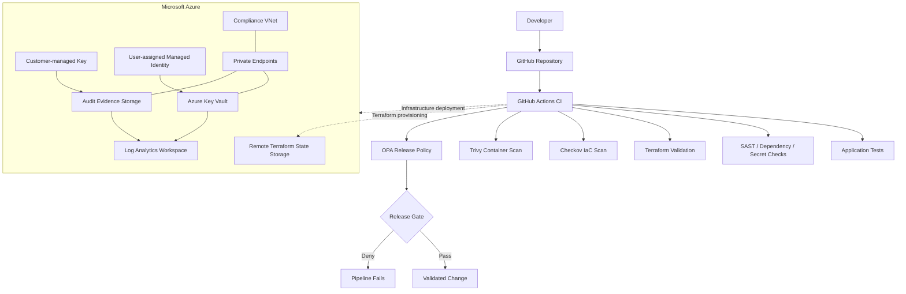
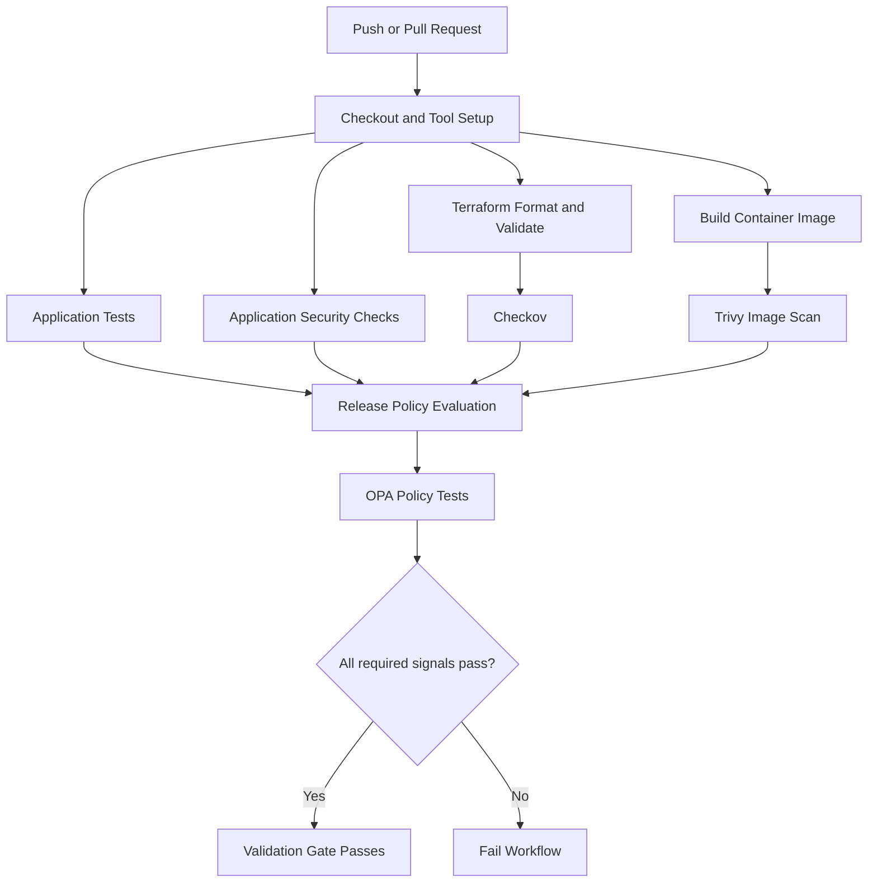

# Production DevSecOps & Compliance-as-Code Pipeline

**Azure | Terraform | GitHub Actions | Checkov | Open Policy Agent | Trivy | Python | Docker**

A security-focused DevSecOps engineering project that brings infrastructure security, application security checks, container scanning, policy-as-code, and Azure compliance controls into a repeatable delivery workflow.

The project demonstrates how a platform or DevSecOps team can make security requirements executable: validate infrastructure before deployment, evaluate release conditions as code, protect sensitive evidence storage, encrypt data with customer-managed keys, and centralize audit telemetry.

> **Project status:** Core Azure compliance infrastructure has been provisioned and Terraform configuration validated. The GitHub Actions validation and policy-gate workflow has passed. The storage account's public network access remains enabled temporarily with a default-deny firewall and a restricted workstation IP allowlist while private runner connectivity is being finalized. This repository documents the implemented state and identifies remaining hardening work rather than claiming every control is already complete.

---

## Table of contents

- [Business problem](#business-problem)
- [Project objectives](#project-objectives)
- [Solution overview](#solution-overview)
- [Architecture](#architecture)
- [Security controls](#security-controls)
- [Technology stack](#technology-stack)
- [Repository structure](#repository-structure)
- [CI security and policy gates](#ci-security-and-policy-gates)
- [Azure infrastructure](#azure-infrastructure)
- [Deployment approach](#deployment-approach)
- [Validation and evidence](#validation-and-evidence)
- [Security decisions and trade-offs](#security-decisions-and-trade-offs)
- [Current limitations and next steps](#current-limitations-and-next-steps)
- [Cleanup and cost management](#cleanup-and-cost-management)
- [What this project demonstrates](#what-this-project-demonstrates)

## Business problem

Cloud delivery teams need to ship changes quickly without allowing insecure application code, vulnerable container images, exposed secrets, or misconfigured cloud infrastructure to reach production.

Manual reviews and informal checklists are difficult to enforce consistently. Security controls are more reliable when they are integrated into the engineering workflow and evaluated automatically.

This project addresses that problem through two complementary layers:

1. **Pipeline enforcement:** automated application, dependency, secret, container, infrastructure, and policy checks.
2. **Azure security foundation:** centralized audit logging, private storage, customer-managed encryption keys, identity-based access, network restrictions, and infrastructure defined as code.

## Project objectives

- Implement repeatable Azure infrastructure using Terraform and remote state.
- Apply secure defaults to Azure Storage and Azure Key Vault.
- Encrypt audit evidence using a Key Vault customer-managed key (CMK).
- Use managed identity and Azure RBAC rather than embedding storage credentials.
- Restrict access to sensitive services through network controls and private endpoints.
- Send Storage Blob and Queue diagnostic data to Log Analytics.
- Integrate security validation into GitHub Actions.
- Use Checkov to evaluate Terraform configuration against security best practices.
- Use Open Policy Agent (OPA) to enforce release conditions as code.
- Scan the built container image with Trivy.
- Preserve evidence that reviewers can inspect and reproduce.

## Solution overview

The implementation is organized into three Terraform layers:

| Layer | Responsibility |
|---|---|
| Bootstrap state | Creates the Azure Storage backend used for Terraform remote state |
| Foundation | Creates the shared resource group, virtual network, subnets, network security groups, and private DNS foundation |
| Compliance infrastructure | Creates Log Analytics, Key Vault, customer-managed key, managed identity, secured Storage Account, private endpoints, and diagnostic settings |

The application and CI workflow provide a repeatable example of how code and infrastructure checks can be evaluated before a release is accepted.

## Architecture

### High-level architecture



The diagram describes the logical design. It does not imply that the GitHub-hosted workflow currently has private network access to Azure private endpoints. The private runner connectivity path is a remaining hardening item.

### Azure network and data protection design

The Azure foundation includes:

- A virtual network using the `10.50.0.0/16` address space.
- A private-endpoint subnet (`10.50.1.0/24`).
- A runner subnet (`10.50.2.0/24`).
- Network security groups associated with the relevant subnets.
- Private DNS zones for Azure Key Vault and Blob Storage.
- Private DNS virtual-network links.
- Private endpoints for the Key Vault and Storage Blob service.

The provisioned private endpoint addresses are:

| Service | Private IP |
|---|---:|
| Key Vault | `10.50.1.4` |
| Storage Blob | `10.50.1.5` |

Private DNS records are associated with the compliance virtual network. A client outside that network does not automatically resolve the private endpoint addresses; it needs the appropriate network path and DNS resolution.

## Security controls

| Area | Implemented control | Purpose |
|---|---|---|
| Infrastructure as Code | Terraform with remote state | Repeatable and reviewable infrastructure changes |
| IaC security | Checkov | Detect insecure Terraform configuration |
| Release policy | OPA/Rego | Enforce required security signals before release |
| Container security | Trivy | Scan the built container image for vulnerabilities |
| Encryption | Azure Key Vault CMK | Customer-controlled key protection for Storage encryption |
| Identity | User-assigned managed identity and Azure RBAC | Avoid storage account keys in application access paths |
| Storage exposure | Private container, anonymous blob access disabled, Shared Key disabled | Reduce accidental data exposure |
| Transport security | HTTPS-only and TLS 1.2 minimum | Protect data in transit |
| Network security | Default-deny rules, restricted IP access, private endpoints | Limit service reachability |
| Auditability | Storage Blob and Queue diagnostics to Log Analytics | Centralize service telemetry |
| Key Vault protection | RBAC, soft delete, purge protection | Protect key-management resources from accidental or malicious deletion |

### Storage security

The audit evidence Storage Account is configured with:

- Standard ZRS replication.
- HTTPS-only traffic and TLS 1.2 minimum.
- Anonymous blob access disabled.
- Shared Key authorization disabled.
- Local users disabled.
- OAuth as the default authentication method.
- Infrastructure encryption enabled.
- A private evidence container named `audit-evidence`.
- Blob versioning and deletion retention.
- A customer-managed key stored in Azure Key Vault.
- A user-assigned managed identity for the encryption integration.
- Diagnostic settings for Blob and Queue services.

**Network status:** the Storage Account currently has public network access enabled temporarily. Its network firewall uses a default-deny action and a restricted workstation IP allowlist. The intended final state is private access through the private endpoint from an authorized runner in the virtual network. Do not interpret the current temporary public endpoint as the final hardened state.

### Key Vault security

The Key Vault is configured with:

- Azure RBAC authorization.
- Soft delete and purge protection.
- A customer-managed RSA 2048-bit key for Storage encryption.
- A private endpoint and private DNS integration.
- Network firewall restrictions.

The key's lifecycle and access permissions should be reviewed periodically. The current Standard Key Vault tier is a deliberate cost-conscious choice; premium HSM-backed key storage is not part of this implementation.

## Technology stack

| Category | Tools and services |
|---|---|
| Cloud | Microsoft Azure |
| Infrastructure as Code | Terraform, AzureRM provider |
| CI/CD | GitHub Actions |
| IaC security | Checkov |
| Policy as Code | Open Policy Agent (OPA), Rego |
| Container security | Trivy |
| Container tooling | Docker |
| Application and tests | Python, Flask, pytest |
| Identity and encryption | Azure RBAC, Managed Identity, Azure Key Vault |
| Network | Azure Virtual Network, NSGs, Private Endpoints, Private DNS |
| Monitoring and audit | Azure Monitor Diagnostic Settings, Log Analytics |

## Repository structure

The repository is organized around application code, policy definitions, automation, and independently managed Terraform layers.

```text
production-devsecops-compliance/
├── .github/
│   └── workflows/
│       └── ci.yml
├── app/
├── tests/
├── infra/
│   ├── bootstrap-state/
│   ├── foundation/
│   └── terraform/
├── policies/
│   ├── release.rego
│   └── release_test.rego
├── scripts/
├── Dockerfile
├── docker-compose.yml
└── README.md
```

The tree above is a logical overview. Consult the repository for the current exact file list.

## CI security and policy gates

The GitHub Actions workflow is designed to validate application changes and infrastructure changes before they are considered releasable.

The release policy evaluates seven required signals:

1. Application tests passed.
2. Static application security analysis passed.
3. Dependency checks passed.
4. Secret scanning passed.
5. Container scanning passed.
6. Infrastructure-as-Code checks passed.
7. Policy tests passed.

The Rego policy denies a release when a required signal is false. Unit tests exercise denial scenarios, including failed container scanning and failed secret scanning, as well as the all-checks-passed scenario.

### Pipeline flow



A passing CI policy gate means the configured validation checks passed for that workflow run. It does not, by itself, mean that an application was deployed to production or that Azure resources were provisioned by CI.

## Azure infrastructure

### Terraform state

Terraform state is stored remotely in an Azure Storage Account and separated by state key for the bootstrap, foundation, and compliance layers.

The state backend is a critical control-plane dependency. Restricting the backend's network access must be coordinated with the runner's network path so that Terraform can continue to read and lock state safely.

### Resource inventory

The deployed compliance layer includes:

- Resource group: `production-devsecops-compliance-rg`
- Virtual network: `devsecops-compliance-vnet`
- Log Analytics workspace: `devsecops-audit-law`
- Key Vault: `devsecops-kv-change01`
- Storage Account: `devsecopsauditchange01`
- Storage container: `audit-evidence`
- User-assigned identity: `devsecops-storage-identity`
- Key Vault CMK: `audit-storage-cmk`
- Key Vault and Blob Storage private endpoints
- Private DNS zones and VNet links
- Blob and Queue diagnostic settings

Resource names are included to make the lab implementation understandable. Reuse in another subscription requires checking global name availability, region availability, policy assignments, quotas, and permissions.

## Deployment approach

> The commands below describe the intended layered deployment sequence. Run them from an authenticated workstation with the required Azure permissions. Review the Terraform variables and backend configuration in each directory before applying. Do not blindly apply infrastructure changes to an existing subscription.

### Prerequisites

- Azure subscription with permission to create the listed resources and role assignments.
- Azure CLI authenticated to the intended tenant and subscription.
- Terraform compatible with the version and provider constraints in the repository.
- Git and Docker.
- Python and pytest for application validation.
- Checkov, Trivy, and OPA for local security and policy validation.

Verify the active Azure context:

```bash
az login
az account show --output table
az account set --subscription "<SUBSCRIPTION_ID>"
```

### 1. Bootstrap remote state

```bash
cd infra/bootstrap-state
terraform init
terraform fmt -check -recursive
terraform validate
terraform plan
```

Review the plan before applying:

```bash
terraform apply
```

### 2. Deploy the foundation

```bash
cd ../foundation
terraform init
terraform fmt -check -recursive
terraform validate
terraform plan
```

Review and apply only after confirming the target subscription, region, network ranges, and resource names:

```bash
terraform apply
```

### 3. Deploy the compliance infrastructure

```bash
cd ../terraform
terraform init
terraform fmt -check -recursive
terraform validate
terraform plan
```

Review the plan carefully, especially Key Vault permissions, Storage firewall rules, private endpoint dependencies, and remote-state connectivity. Then apply:

```bash
terraform apply
```

### 4. Run security and policy checks

Run the repository's configured CI workflow for the authoritative job definitions. The following are representative local checks; adjust paths or arguments to match the installed tool versions and workflow:

```bash
terraform fmt -check -recursive
terraform validate
checkov -d infra/bootstrap-state
checkov -d infra/foundation
checkov -d infra/terraform
opa test policies/ -v
```

Build and scan the container using the repository's Dockerfile and image naming convention:

```bash
docker build -t production-devsecops-compliance:local .
trivy image production-devsecops-compliance:local
```

Do not treat a local command as a substitute for the full GitHub Actions workflow. Use the workflow result and its logs as the record of what ran for a particular commit.

## Validation and evidence

The implementation has produced the following verified results during development:

- Terraform validation completed successfully for the compliance configuration.
- A subsequent Terraform plan reported no changes at that point in time.
- Azure Storage Account provisioning completed successfully.
- Storage was verified as Standard ZRS, TLS 1.2 minimum, Shared Key disabled, anonymous blob access disabled, and firewall default action set to Deny.
- The Blob private endpoint was provisioned and its connection status was Approved.
- The Key Vault private endpoint was provisioned.
- Private DNS records were created for the Key Vault and Blob private endpoint addresses and linked to the compliance VNet.
- Storage Blob and Queue diagnostic settings were created.
- The GitHub Actions workflow's release-policy job passed.
- A Checkov run for the compliance layer reported 22 passed, 1 failed, and 4 skipped. The remaining failure was the Storage Account public network access check, which is intentionally not suppressed while the temporary public endpoint remains enabled.

### Checkov exceptions

A small number of checks are skipped with documented rationale where the check does not match the selected design or where a cost-conscious lab choice is intentional. Examples include:

- Standard Key Vault rather than premium HSM-backed Key Vault.
- ZRS rather than cross-region replication.
- Queue diagnostics configured through the dedicated queue properties resource.
- Blob diagnostics configured at the Blob service level.

A skipped check is not a passed check. Review every skip and exception when adapting this design for a regulated production environment.

### Evidence to publish

Add sanitized evidence under a dedicated directory as it is collected. Recommended artifacts:

- GitHub Actions workflow run screenshot and job summary.
- Terraform validation and plan output with sensitive values removed.
- Checkov JSON or SARIF report.
- OPA test output.
- Trivy scan report.
- Azure screenshots showing Key Vault protection, Storage security configuration, private endpoint approval, DNS records, and diagnostic settings.

Never commit credentials, access tokens, private keys, Terraform state files, sensitive plan files, or unredacted environment output.

## Security decisions and trade-offs

### Why Terraform remote state?

Remote state provides a shared source of truth for infrastructure changes and supports team workflows. The backend must be protected as carefully as the infrastructure it manages because state can contain sensitive resource attributes.

### Why customer-managed keys?

A customer-managed key provides explicit control over the key used to protect Storage data. It also introduces a dependency on Key Vault availability, identity permissions, key lifecycle management, and network reachability. Those dependencies must be monitored and tested.

### Why managed identity?

Managed identity avoids distributing long-lived storage credentials to workloads. Azure RBAC provides a more manageable authorization model than shared account keys.

### Why private endpoints?

Private endpoints provide private IP connectivity to supported Azure services from a connected virtual network. They are only effective when routing, DNS, network security rules, and the client execution environment are configured correctly.

### Why ZRS?

Zone-redundant storage provides redundancy across availability zones in the selected Azure region. It is not a substitute for cross-region disaster recovery. Cross-region replication is a separate design decision and is not claimed by this project.

### Why a Standard Key Vault?

The Standard tier keeps the lab cost-conscious while demonstrating RBAC, key management, soft delete, purge protection, and CMK integration. It does not provide the same HSM-backed key protection as the Premium tier.

## Current limitations and next steps

The following work should be completed before describing the environment as fully production-hardened:

1. **Private runner connectivity:** establish an authorized runner with a working private network path to the compliance VNet and private endpoints.
2. **Private DNS verification from the runner:** verify Key Vault and Blob hostnames resolve to their private IP addresses from inside the connected network.
3. **Terraform backend connectivity:** ensure the runner can reach the separate remote-state Storage Account securely before tightening backend network access.
4. **Storage public access closure:** after private runner and backend access are verified, disable public network access on the audit evidence Storage Account and rerun Terraform and Checkov.
5. **End-to-end data-plane tests:** verify the intended managed identity can perform only the required Storage and Key Vault operations.
6. **Operational alerting:** define actionable alerts for diagnostic pipeline failures, key expiry, authorization failures, and suspicious access patterns.
7. **Recovery testing:** document and test backup, key recovery, state recovery, and regional recovery procedures appropriate to the selected services.
8. **Production governance:** integrate organization-specific Azure Policy assignments, approval requirements, environment protection rules, and separation of duties where required.

## Cleanup and cost management

Azure resources can incur charges even when they are not actively used. Review the resource inventory and cost estimates before deployment.

For temporary lab environments:

- Avoid leaving compute resources running when not needed.
- Review Log Analytics ingestion and retention costs.
- Review Storage, Key Vault, private endpoint, and networking charges.
- Preserve remote Terraform state until all dependent infrastructure has been safely removed.
- Destroy resources in dependency order using the Terraform configuration that created them.
- Do not manually delete the state backend or state files before the dependent Terraform stacks have been destroyed and state is no longer required.

Never run `terraform destroy` against a shared subscription without reviewing the plan and confirming the exact workspace, backend, and resource scope.

## What this project demonstrates

This project is designed to demonstrate practical capability in:

- Building Azure infrastructure with modular, layered Terraform workflows.
- Designing remote state and managing infrastructure dependencies.
- Integrating application and infrastructure security checks into CI.
- Writing and testing release policies with OPA/Rego.
- Scanning container images with Trivy.
- Applying Azure Key Vault, CMK, managed identity, and RBAC controls.
- Securing Storage Accounts and private endpoints.
- Configuring Azure diagnostic settings and centralized audit telemetry.
- Interpreting security scanner findings, documenting exceptions, and prioritizing remediation.
- Making engineering trade-offs based on security, operational complexity, and cloud cost.

---

## Author

**George Omololu Akinbi**  
Cloud & DevOps Engineer | Platform Engineering | DevSecOps

- GitHub: [@georgelolu](https://github.com/Georgelolu)
- LinkedIn: [linkedin.com/in/georgelolu](https://www.linkedin.com/in/georgelolu)
- Email: [georgelolu@gmail.com](mailto:georgelolu@gmail.com)

---

*This is an engineering portfolio project. It demonstrates security architecture and implementation practices in an Azure lab environment; it is not a certification of regulatory compliance or a claim that the environment has undergone an independent production security audit.*
