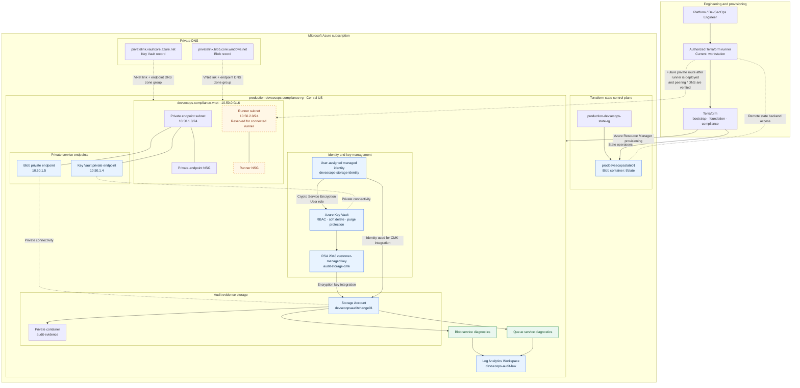

# Azure Enterprise Security Architecture

This document describes the Azure security foundation implemented by the Production DevSecOps & Compliance-as-Code Pipeline.

It separates **deployed Azure components** from **planned runner connectivity** so the diagram does not imply that private access has already been completed end to end.

## 1. Architecture diagram

## 2. Resource and trust boundaries

| Boundary | Components | Responsibility |
|---|---|---|
| Terraform state | `production-devsecops-state-rg`, `proddevsecopsstate01`, `tfstate` | Stores Terraform state separately from the compliance resources |
| Compliance network | `devsecops-compliance-vnet` | Provides address space and subnets for private service connectivity |
| Private endpoint subnet | `10.50.1.0/24` | Hosts the Key Vault and Blob private endpoint network interfaces |
| Runner subnet | `10.50.2.0/24` | Reserved for an authorized runner; end-to-end runner connectivity is not yet complete |
| Key management | Key Vault, CMK, UAMI, Azure RBAC | Controls the customer-managed encryption key and the identity permitted to use it |
| Evidence storage | Storage Account and private container | Stores audit evidence with restricted access and encryption controls |
| Audit pipeline | Azure Monitor diagnostic settings and Log Analytics | Centralizes Blob and Queue service diagnostics |
| Private name resolution | Two Azure Private DNS zones and VNet links | Resolves supported service hostnames to private endpoint addresses for clients using the VNet DNS path |

## 3. Implemented network addressing

| Resource | Address / range | Status |
|---|---:|---|
| Compliance VNet | `10.50.0.0/16` | Provisioned |
| Private endpoint subnet | `10.50.1.0/24` | Provisioned |
| Runner subnet | `10.50.2.0/24` | Provisioned; runner not deployed |
| Key Vault private endpoint | `10.50.1.4` | Provisioned; connection approved |
| Blob private endpoint | `10.50.1.5` | Provisioned; connection approved |

## 4. Security flows

### Terraform provisioning and state

1. An authorized operator runs Terraform from the current workstation.
2. Terraform reads and writes remote state in the separate bootstrap Storage Account.
3. Terraform uses Azure Resource Manager to manage the foundation and compliance resources.
4. State-backend network reachability must be preserved when runner and firewall controls are changed.

### Customer-managed encryption

1. The Storage Account is configured to use a customer-managed key in Azure Key Vault.
2. A user-assigned managed identity is associated with the Storage Account.
3. The identity receives the Key Vault Crypto Service Encryption User role at the Key Vault scope.
4. Key Vault RBAC, network reachability, key lifecycle and service configuration must all remain valid for this integration to work.

### Private service connectivity

1. Private endpoints provide private IP addresses for the Key Vault and Blob service.
2. Private DNS zones contain records for those private endpoint addresses.
3. The DNS zones are linked to the compliance VNet.
4. A client must be connected to the VNet (or a correctly routed and DNS-integrated network) to use the private endpoint path.
5. The current workstation is outside the VNet, so its public DNS resolution is expected until a connected runner/network path is established.

### Audit telemetry

1. Blob and Queue service diagnostic settings send configured logs and metrics to Log Analytics.
2. Log Analytics provides a centralized destination for operational review and audit investigation.
3. Retention, ingestion volume, alert rules and access permissions should be reviewed for a production deployment.

## 5. Current network-hardening status

**Implemented**
- Compliance VNet, subnets and network security groups.
- Key Vault and Blob private endpoints.
- Private DNS zones, endpoint DNS zone groups and VNet links.
- Key Vault RBAC, soft delete and purge protection.
- Storage firewall default action set to Deny with a restricted workstation IP allowlist.
- Storage Blob and Queue diagnostics configured.

**Still required**
- Deploy an authorized runner with private connectivity to the compliance VNet.
- Verify private DNS resolution and HTTPS access from that runner.
- Establish secure access to the separate Terraform state backend from the runner.
- Only after those tests pass, disable public network access on the audit evidence Storage Account and validate Terraform, data-plane access and Checkov again.

The runner subnet in the diagram is a provisioned network segment, not proof that a runner VM or private execution path exists. The state Storage Account is also a separate resource and is not represented as having a private endpoint in this design.

## 6. Design notes

- **ZRS is regional resilience:** it protects against availability-zone failures in the selected region; it is not cross-region disaster recovery.
- **Private endpoint does not equal private-only service:** public network access is a separate service setting and must be explicitly disabled after private connectivity is verified.
- **Private DNS is network-scoped:** a DNS record in an Azure Private DNS zone does not make a workstation outside the linked network resolve the private IP automatically.
- **Terraform state is critical:** do not remove or firewall off the backend until an alternate authorized access path has been tested.
- **Cost is a design input:** the Standard Key Vault tier and ZRS selection reflect the current cost-conscious lab scope, not a claim of HSM-backed or cross-region protection.

## 7. Related documentation

- [Project overview and deployment guide](../../README.md)
- [CI workflow](../../.github/workflows/ci.yml)
- [Terraform bootstrap state](../../infra/bootstrap-state/)
- [Terraform foundation](../../infra/foundation/)
- [Terraform compliance infrastructure](../../infra/terraform/)
