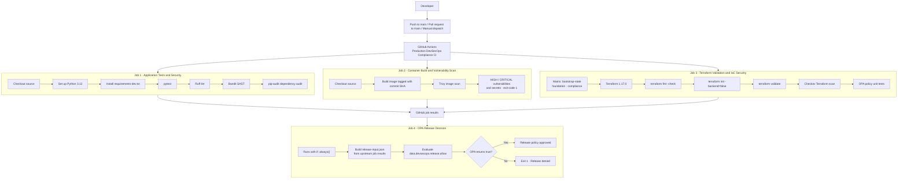
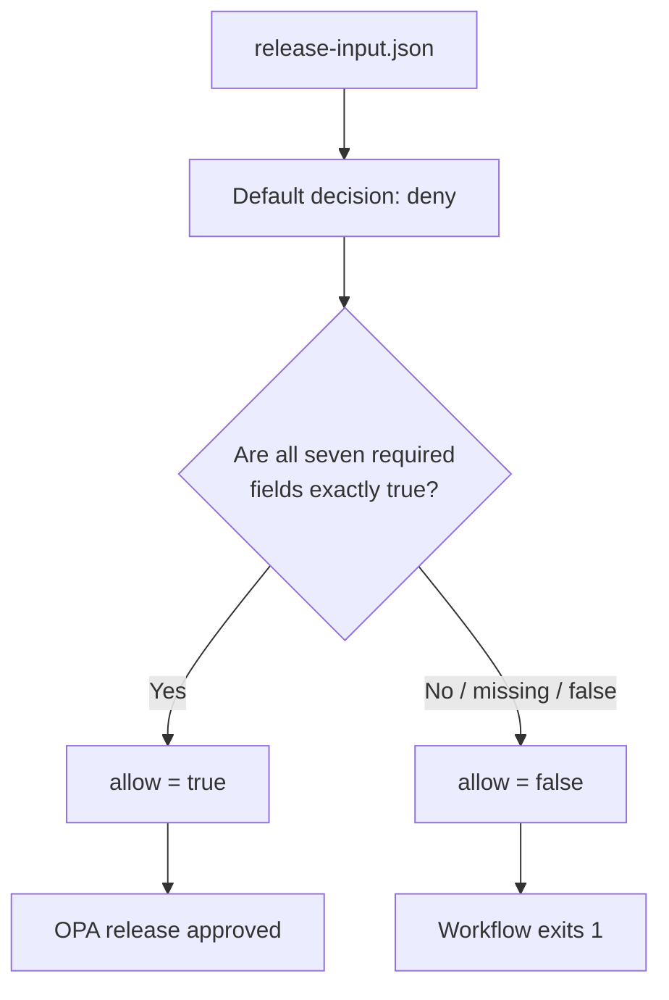

# CI/CD Security Pipeline Architecture

This document explains the GitHub Actions workflow and OPA release decision implemented in this repository. It is based on the current `.github/workflows/ci.yml`, `policies/release.rego`, and `policies/release_test.rego`.

## 1. Pipeline architecture

The three validation jobs run independently. The release-policy job depends on all three and uses `if: always()` so it can evaluate the upstream job outcomes even when one of them fails. The workflow's release gate is a CI validation decision; this workflow does not deploy the application to Azure.

## 2. Trigger and execution model

The workflow is named **Production DevSecOps Compliance CI** and runs on:

- Pushes to `main`.
- Pull requests targeting `main`.
- Manual `workflow_dispatch`.

Workflow permissions are restricted to `contents: read`. Concurrency is grouped by Git reference and an in-progress run in the same group is cancelled when a newer run starts.

All jobs currently use GitHub-hosted `ubuntu-latest` runners. The workflow does not currently authenticate to Azure or provision Azure infrastructure.

## 3. Job-level controls

### Job 1 — Application Tests and Security

| Step | Tool | What it checks |
|---|---|---|
| Test suite | pytest | Executes application tests |
| Lint | Ruff | Checks Python code quality and lint rules |
| Static analysis | Bandit (`-ll`) | Reports Python security findings at the configured severity threshold |
| Dependency audit | pip-audit | Audits dependencies declared in `requirements.txt` |

The job uses Python 3.12, installs `requirements-dev.txt), and caches pip dependencies using the requirements files as cache inputs.

### Job 2 — Container Build and Vulnerability Scan

1. Checks out the repository.
2. Builds the Docker image and tags it with the Git commit SHA.
3. Runs the Aqua Security Trivy GitHub Action.
4. Scans for vulnerabilities and secrets.
5. Configures the scan to report HIGH and CRITICAL severity findings, ignore unfixed vulnerabilities, and return a failing exit code when matching findings are detected.

The scan uses table output and the `vuln,secret` scanners.

### Job 3 — Terraform Validation and IaC Security

A GitHub Actions matrix evaluates three independent Terraform directories:

- `infra/bootstrap-state`
- `infra/foundation`
- `infra/terraform`

For each directory the workflow:

1. Installs Terraform 1.17.0.
2. Checks formatting recursively.
3. Initializes Terraform with `-backend=false`, avoiding access to the configured remote backend during CI validation.
4. Runs `terraform validate -no-color`.
5. Installs Checkov and scans the directory using the Terraform framework.
6. Runs OPA policy unit tests using the OPA 1.10.0 container.

The bootstrap-state scan has explicitly listed Checkov skips with comments explaining the current state-backend design constraints. The other two directories run Checkov without those bootstrap-specific skip arguments. A skipped Checkov rule is an exception, not a passing test.

## 4. OPA release decision

The release decision is implemented in:

- `policies/release.rego`
- `policies/release_test.rego`

The Rego package is `devsecops.release`. Its default decision is `allow := false`. It allows the release only when all seven input fields are exactly `true`:

| Policy input | Meaning |
|---|---|
| `tests_passed` | Application test job succeeded |
| `sast_passed` | Application security job succeeded |
| `dependencies_passed` | Application security job succeeded |
| `secrets_passed` | Container security job succeeded |
| `container_passed` | Container security job succeeded |
| `iac_passed` | Terraform validation job succeeded |
| `policy_tests_passed` | Terraform validation job succeeded, including its OPA test step |

### How the workflow builds policy input

The release-policy job reads the GitHub Actions results for the three upstream jobs and writes `release-input.json`.

The current mapping is:

| Upstream GitHub job result | Policy fields set from that result |
|---|---|
| `application-security` | `tests_passed`, `sast_passed`, `dependencies_passed` |
| `container-security` | `secrets_passed`, `container_passed` |
| `terraform-validation` | `iac_passed`, `policy_tests_passed` |

A job result is considered passed only when its result string equals `success`. Any other result produces `false` for the associated policy fields. OPA evaluates `data.devsecops.release.allow`; if the result is not the literal `true`, the workflow exits with code 1 and reports that the release is denied.

**Important implementation nuance:** these seven policy inputs are derived from three job-level results. They are not seven independently uploaded or independently evaluated step attestations. For example, the three application-related policy booleans all reflect the overall application-security job result.

## 5. Policy unit tests

The OPA tests currently cover three scenarios:

1. **Allow:** all seven required inputs are true.
2. **Deny:** the container scan input is false.
3. **Deny:** the secrets check input is false.

These tests verify the central allow/deny behavior of the policy. Additional negative tests can be added for each individual input to strengthen regression coverage.

## 6. Release decision logic

The policy uses a fail-closed default. Missing or false required fields do not satisfy the allow rule.

## 7. What a green workflow means

A successful workflow means that the configured jobs completed successfully for that commit or pull request:

- Application tests, Ruff, Bandit and pip-audit passed.
- Container build and configured Trivy scan passed.
- Terraform formatting, backend-independent initialization, validation and Checkov passed across the matrix directories.
- OPA policy tests passed.
- The OPA release decision returned `true`.

A green workflow does **not** currently mean:

- Terraform applied infrastructure to Azure.
- An application was deployed to an Azure environment.
- The workflow used a self-hosted runner or connected to private Azure endpoints.
- Every policy input was produced by a separate independent security attestation.
- The project has been independently audited or certified against a regulatory framework.

## 8. Current design boundaries and future improvements

The existing workflow is a validation and policy-gating pipeline. The following are potential next engineering improvements, not claims about current implementation:

1. Add explicit secret-scanning tooling as a dedicated job instead of deriving the `secrets_passed` input from the container job result.
2. Generate distinct machine-readable results for each policy signal, then build OPA input from those individual results.
3. Add artifact upload for test reports, Checkov output, Trivy reports, and OPA decision input/output, with secret redaction.
4. Pin third-party GitHub Actions to immutable commit SHAs and define an update process.
5. Add least-privilege Azure authentication using GitHub OIDC only if/when a controlled Azure deployment job is introduced.
6. Add protected environment approvals and deployment stages if the project evolves from validation into continuous delivery.
7. Add a self-hosted or securely connected runner only when private Azure data-plane operations are required by the pipeline.

## 9. Related documentation

- [Project overview and deployment guide](../../README.md)
- [Azure enterprise security architecture](./azure-enterprise-security-architecture.md)
- [GitHub Actions workflow](../../.github/workflows/ci.yml)
- [OPA release policy](../../policies/release.rego)
- [OPA policy tests](../../policies/release_test.rego)
